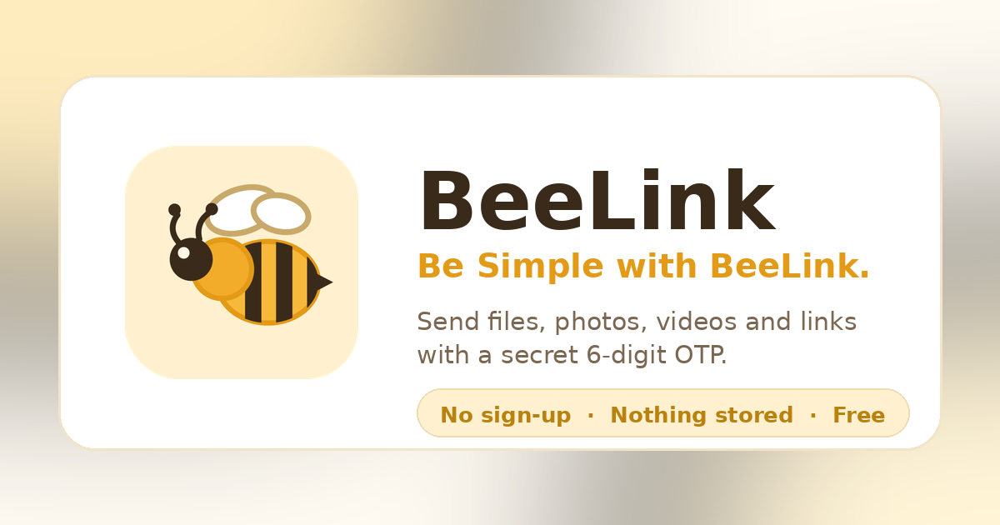
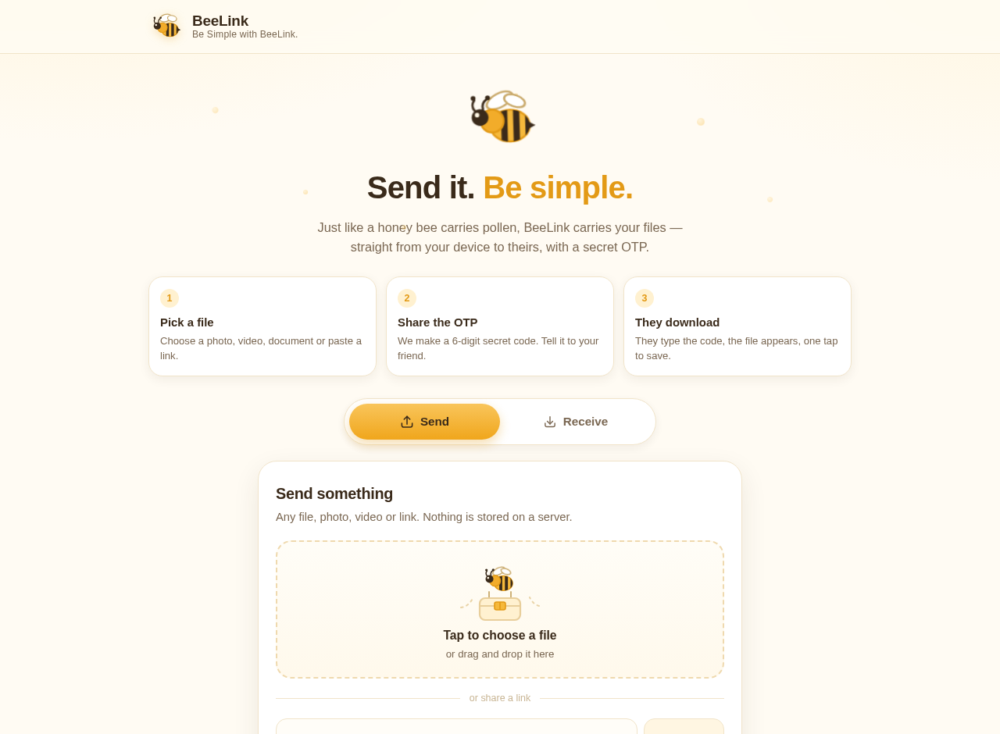

<div align="center">
  
</div>

<br>

<div align="center">

# BeeLink

**Be Simple with BeeLink.**

Send a file, a photo, a video or a link straight from one device to another using a secret 6-digit OTP. No account, no upload, no copy left behind.

<br>

[](LICENSE)
[](#install-as-an-app)
[](#how-it-works)
[-F6B93B?style=flat-square)](https://peerjs.com)
[](#tech-stack)
[](#contributing)

<sub>Built and maintained by <a href="https://github.com/ItsNobodyX">ItsNobodyX</a></sub>

</div>

---

## Contents

- [Overview](#overview)
- [Features](#features)
- [How it works](#how-it-works)
- [Screenshot](#screenshot)
- [Quick start](#quick-start)
- [Install as an app](#install-as-an-app)
- [Project structure](#project-structure)
- [Tech stack](#tech-stack)
- [Security and privacy](#security-and-privacy)
- [Browser support](#browser-support)
- [Limitations](#limitations)
- [SEO and metadata](#seo-and-metadata)
- [Contributing](#contributing)
- [Licence](#licence)
- [Author](#author)

---

## Overview

BeeLink exists for one stubborn reason: handing a file to another person should be easy for everyone, at every age.

A honey bee carries pollen from one flower to the next without a warehouse in between. BeeLink carries your files the same way: from your browser to theirs, over an encrypted peer-to-peer connection, with a six-digit code as the only thing that joins the two ends.

There is no backend. No database, no object storage, no analytics, no sign-up. The page you load is the entire product.

---

## Features

| | |
| --- | --- |
| **OTP pairing** | A random six-digit code is generated per transfer. The code *is* the peer address, so the receiver only has to type it. |
| **True peer-to-peer** | File bytes travel over a WebRTC data channel, encrypted with DTLS. No server relays the payload. |
| **Anything you can send** | Files of any type, photos, videos, audio, documents, or just a link. |
| **Nothing stored** | The item lives in browser memory on the two devices and nowhere else. |
| **Works as an app** | Installable PWA with a service worker, so the shell opens instantly and survives going offline. |
| **Age-friendly design** | Large tap targets, plain language, no dark patterns, readable contrast, single column on a phone. |
| **Custom icon set** | Every icon and illustration is hand-drawn inline SVG on a 24 x 24 grid. No emoji, no icon fonts, identical on every platform. |
| **Real motion design** | Staggered entrances, a sliding tab pill, a bee that rides the progress bar, a self-drawing tick on success, all disabled under `prefers-reduced-motion`. |
| **Accessible** | Real buttons and labels, `aria-selected` tabs, `aria-live` status messages, visible focus rings, keyboard-operable drop zone. |
| **Zero build step** | No bundler, no framework, no compilation. Open the file and it runs. |

---

## How it works

The OTP is not a password checked by a server. It is a **peer address** the sender reserves on the signalling network, so the receiver can dial it directly.

```
      SENDER                                          RECEIVER
        │                                                │
        │  1. reserves peer id  beelink-v1-482913        │
        │     (the OTP itself is the address)            │
        │                                                │
        │  2. shows  4 8 2 9 1 3  ────── read aloud ────▶ typed by hand
        │                                                │
        │  ◀────────  3. WebRTC handshake  ─────────▶    │  dials
        │             via a public signalling broker     │  beelink-v1-482913
        │                                                │
        │  ══════  4. encrypted DTLS data channel  ══════▶
        │                                                │
        │      {meta} ──▶ {accept} ──▶ chunks ──▶ {ack}  │
        │      ◀──────────────────────────── {done}      │
        │                                                │
        │  5. receiver assembles a Blob and offers it    │
        │     for download                               │
```

**The transfer protocol.** Files are sliced into 64 KB chunks. The sender keeps at most 16 chunks, 1 MB, in flight, and waits for cumulative acknowledgements from the receiver, which are sent roughly once per megabyte. That keeps memory flat and stops a fast sender from overwhelming a slow link. Both progress bars report acknowledged bytes, not optimistic ones.

| Message | Direction | Purpose |
| --- | --- | --- |
| `{t:'meta', kind, name, size, mime}` | sender to receiver | announces the item |
| `{t:'accept'}` | receiver to sender | ready, start streaming |
| `ArrayBuffer` | sender to receiver | one 64 KB chunk |
| `{t:'ack', n}` | receiver to sender | "I have n bytes, keep going" |
| `{t:'done'}` | receiver to sender | item saved on the receiver's side |
| `{t:'complete'}` | sender to receiver | no more chunks |
| `{t:'error', message}` | either | reports a failure |

If the generated OTP is already taken on the network, a new one is drawn automatically, up to six attempts, so two people never collide.

---

## Screenshot

<div align="center">
  
</div>

---

## Quick start

There is nothing to install and nothing to build.

**Just look at it**

```bash
git clone https://github.com/ItsNobodyX/BeeLink.git
cd BeeLink
open index.html        # or double-click it
```

The full OTP pairing flow works straight from `file://`.

**Run it properly**: needed for installation and offline caching, because service workers require a secure context:

```bash
python3 -m http.server 8080
# then open http://localhost:8080
```

**Host it**: upload the folder to any static host: GitHub Pages, Netlify, Cloudflare Pages, Vercel, S3, or a plain web server. No server-side code, no environment variables, no configuration.

> The service worker registers only over `https://` or `localhost`. On plain `http://` the app still works; it simply will not install or cache.

---

## Install as an app

| Platform | How |
| --- | --- |
| Chrome, Edge, Samsung Internet | Press **Install app** in the header, or use the install icon in the address bar |
| Safari on iOS / iPadOS | Share, then **Add to Home Screen** |
| Firefox desktop | Installs as a bookmark-style app |

The header button appears only when installation is actually possible. On iOS, where the prompt API does not exist, it explains the Share route instead. Once installed it hides itself.

---

## Project structure

```
beelink/
├── index.html              # the entire application: HTML, CSS, artwork and JS
├── manifest.webmanifest    # app name, colours, icons, standalone display
├── sw.js                   # service worker: caches the shell for offline use
├── icon.svg                # vector app icon
├── icon-192.png            # raster app icon
├── icon-512.png            # raster app icon, also used as maskable
├── og-image.png            # 1200 x 630 social sharing card
├── banner.png              # README header
├── screenshot.png          # README screenshot
├── LICENSE
└── README.md
```

`index.html` is self-sufficient: open it and the app runs. The manifest and service worker add installability and offline caching, which browsers will not accept from a blob or data URL, so a genuine PWA needs those two small companions served alongside the page.

---

## Tech stack

| Layer | Choice | Why |
| --- | --- | --- |
| Markup, styles, logic | Hand-written HTML, CSS and vanilla JavaScript | No framework to load, nothing to compile, one file to deploy |
| Transport | WebRTC data channels | Native, encrypted, peer-to-peer, no relay |
| Signalling | [PeerJS](https://peerjs.com) 1.5.4 (MIT) | Handles the WebRTC handshake without a bespoke server |
| Icons and artwork | Inline SVG | Crisp at any size, themable, no external requests |
| Offline | Service worker + web app manifest | Installable, instant repeat loads |
| Fonts | System UI stack | No font download, no layout shift |

---

## Security and privacy

**What is protected**

- File contents cross an encrypted DTLS data channel between the two browsers. No third party carries the payload.
- Nothing is written to a server, a database or a CDN, because no such storage exists in this project.
- There is no account, no cookie for advertising, and no analytics script.

**What to be aware of**

- A **public signalling broker** introduces the two browsers and exchanges the handshake. It sees connection metadata such as IP addresses and timestamps, and the peer id, which is the OTP. It never sees your file bytes. If that metadata exposure matters to you, run your own PeerJS server and point the client at it.
- The **OTP is an address, not a password**. Anyone holding it while a transfer is live can collect the item. Share it the way you would share a door key.
- The receiver's copy lives in a temporary in-memory Blob until the page is closed.

---

## Browser support

| Browser | Transfer | Install |
| --- | --- | --- |
| Chrome, Edge, Opera (desktop and Android) | Yes | Yes |
| Safari 15+ (macOS and iOS) | Yes | iOS via Add to Home Screen |
| Firefox (desktop and Android) | Yes | Desktop yes, Android limited |
| Internet Explorer | No | No |

Requires WebRTC data channels, `Blob` and `URL.createObjectURL`.

---

## Limitations

- **Both people must be online at the same time.** BeeLink is a live hand-off, not a mailbox.
- **The sender's page must stay open** until the transfer finishes; the OTP lives only as long as that page does.
- **One receiver at a time.** A second caller is politely refused while a transfer is in progress.
- **Some networks block peer-to-peer.** Corporate firewalls and symmetric NATs without a TURN server can prevent a connection. Adding a TURN server to the PeerJS configuration is the fix where you control the network.
- **Very large files are memory-bound on the receiver**: the whole file is assembled in memory before the download is offered. A few hundred megabytes is comfortable on a modern phone; multi-gigabyte files belong in a streaming service.
- **Signalling depends on a free public broker**, which may be rate-limited. For production, host your own PeerJS server.

---

## SEO and metadata

The `<head>` carries a full metadata set: primary SEO tags, crawler directives, canonical and `hreflang` links, icons and PWA tags, 13 Open Graph tags, 6 Twitter card tags, resource hints, and a JSON-LD `@graph` describing the app, the site and the author.

**Before publishing, replace the placeholder domain.** Every absolute URL uses `https://your-domain.com`; swap it for your real origin in the canonical block, the Open Graph block, the Twitter block and the structured data. Adding a `robots.txt` and `sitemap.xml` at the site root completes the picture.

---

## Contributing

Bug reports and pull requests are welcome at [github.com/ItsNobodyX](https://github.com/ItsNobodyX).

```bash
git checkout -b fix/short-description
# make your change
git commit -m "Fix: short description"
git push origin fix/short-description
```

Please keep the project's constraints intact: one self-contained page, no build step, no framework, no runtime dependency beyond PeerJS, and no emoji in the interface. By submitting a contribution you agree that it may be distributed under the project's licence, including future releases of it.

---

## Licence

BeeLink is released under the **MIT Licence** for its source code, see [LICENSE](LICENSE). You may use, modify, merge, publish, distribute, sublicense and sell the code, including commercially, provided the copyright notice is retained.

The licence document has two parts. **Part I** is the MIT Licence, kept in its standard unmodified form so the project stays genuinely open source. **Part II** is a Copyright and Brand Notice covering what MIT never granted: the BeeLink name, the bee mark, the icons, the illustrations, the sharing card and the written copy. Those remain reserved, and the notice sets out the protection they enjoy under the Berne Convention, the WIPO Copyright Treaty and TRIPS, and under the Copyright Act, 1957 (India), Title 17 of the United States Code and the Lanham Act, the EU copyright and trade mark directives, and the Copyright, Designs and Patents Act 1988 (United Kingdom).

In short: the code is yours to build on. The identity is not. Do not ship a modified version under the BeeLink name, and do not lift the artwork into another product.

BeeLink is built with [PeerJS](https://peerjs.com), distributed under the MIT Licence. All other code, iconography and illustration are original.

---

## Author

**ItsNobodyX**

[](https://github.com/ItsNobodyX)

<div align="center">
  <sub>Be Simple with BeeLink.</sub>
</div>
